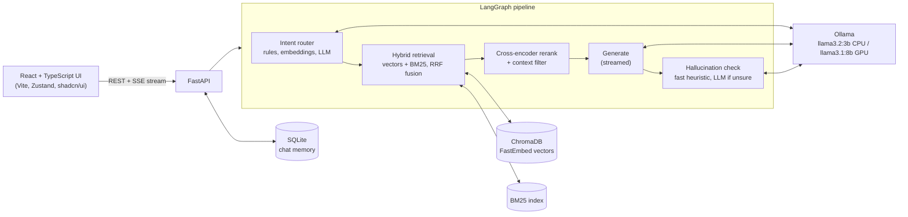

# Axiom RAG

[](https://github.com/Lerner98/axiom-rag/actions/workflows/ci.yml)
[](LICENSE)

**Ask questions about your own documents and get answers with their sources, entirely on your own computer.**

Axiom RAG is a local-first document Q&A app: a React frontend and a FastAPI + LangGraph backend
that combines hybrid search (vectors + BM25), cross-encoder reranking and a hallucination check,
with a local LLM through Ollama. No cloud services, no API keys, and it runs without a GPU.

https://github.com/user-attachments/assets/250c865e-c7f3-4fc5-b177-8ee6c2bb24f3

*Real recording on CPU only (no graphics card): upload a policy document, ask a two-part question,
get the answer with the source it came from. The answer check is shown at 4x speed.*

## Features

- **Documents:** PDF, Word (.docx), TXT and Markdown, split into parent-child chunks
- **Hybrid retrieval:** FastEmbed vectors in ChromaDB plus BM25 keyword search, fused with RRF
- **Reranking:** a cross-encoder (`ms-marco-MiniLM-L-6-v2`) picks the passages the LLM sees
- **Grounded answers:** every answer cites its sources; a hybrid check (deterministic + LLM) flags ungrounded answers
- **Intent routing:** greetings and follow-ups skip retrieval; questions take a fast or a full path
- **Streaming:** sources arrive first, then the answer token by token
- **Isolation:** each chat has its own document collection and conversation memory
- **Runs anywhere:** `COMPUTE_DEVICE=cpu` runs everything on the processor; a GPU is optional

## Try it on your PC (Windows, no GPU needed)

1. **Download** the project: click the green **Code** button on this page, then **Download ZIP**.
   Unzip it somewhere short, for example your Desktop.
2. **Double-click `Start-Axiom.bat`** in the unzipped folder.
   - If Windows shows "Windows protected your PC", click **More info**, then **Run anyway**.
   - The first run installs what it needs (Python, Node.js and Ollama if missing) and downloads
     the AI model. It takes about 10-20 minutes and needs ~5 GB of free disk space.
     Later runs start in under a minute.
3. Your browser opens at **http://localhost:8080**. Click **New chat**, then **+** > **Add files**
   to upload a document (there is a sample in [`sample-docs/`](sample-docs)), and ask a question.

Keep the black window open while you use the app; close it to stop.
Everything runs on your computer. Your documents never leave it.

**No graphics card? No problem.** Setup checks for an NVIDIA GPU with 6 GB+ of memory. If it
finds one, it uses `llama3.1:8b` on the GPU. Otherwise it runs `llama3.2:3b` on the processor
(CPU mode), or `llama3.2:1b` on PCs with less than 8 GB of memory.

| Measured on an Intel Core Ultra 9 285K, CPU only (GPU unused) | Time |
|---|---|
| First words of the answer (median) | 2.1 s |
| Complete answer (median / slowest of 5) | 4.5 s / 6.8 s |
| Same, limited to 4 CPU threads (closer to a typical laptop) | 6.2 s / 10.1 s |
| Two-part question in the UI (the recording above) | ~13 s to full answer, ~24 s with the hallucination check |

A typical office laptop is slower than this desktop. As an estimate (not measured), expect roughly
10-40 seconds per answer. Details: [docs/benchmark-results.md](docs/benchmark-results.md).

<details>
<summary><b>Options and troubleshooting</b></summary>

Run from PowerShell in the project folder (or pass the same options to `Start-Axiom.bat`):

```powershell
.\setup.ps1 -Mode cpu                 # force CPU mode even if you have a GPU
.\setup.ps1 -Mode gpu                 # force GPU mode
.\setup.ps1 -Model llama3.2:1b        # smaller, faster model for older PCs
.\setup.ps1 -InstallOnly              # install everything, don't start
```

Settings live in `backend/.env` (see [`backend/.env.example`](backend/.env.example)). The key ones are
`OLLAMA_MODEL`, `COMPUTE_DEVICE` (`auto` / `cpu` / `gpu`) and `OLLAMA_NUM_THREAD`. Logs go to `logs/`.

| Problem | Fix |
|---|---|
| "This folder's location is too long for Windows" | Move the unzipped folder somewhere short, such as `C:\Axiom` or your Desktop. |
| "Port 8001/8080 is already in use" | Axiom is already running in another window. Close it and try again. |
| Setup says Python/Node "was installed but this window cannot see it yet" | Close the window and double-click `Start-Axiom.bat` again. |
| `winget` is missing (older Windows 10) | Install **App Installer** from the Microsoft Store, or install [Python 3.12](https://www.python.org/downloads/), [Node.js LTS](https://nodejs.org/) and [Ollama](https://ollama.com/download) yourself, then run again. |
| Answers are very slow | Run `Start-Axiom.bat -Model llama3.2:1b`. |

</details>

## Architecture



A question first goes through the **intent router** (cheap rules, then embedding similarity, then
the LLM only when unsure). Questions about the documents run **hybrid retrieval**: FastEmbed vector
search and BM25 keyword search are fused with Reciprocal Rank Fusion and expanded to their parent
chunks. A **cross-encoder** reranks the candidates, and the top passages are streamed to the UI as
sources **before** generation starts. After the answer streams, a **groundedness check** compares it
with the sources: a fast word/trigram overlap score, with an LLM verdict only for ambiguous cases.

## Tech stack

| Layer | Technology |
|---|---|
| Frontend | React 18, TypeScript, Vite, Tailwind CSS, shadcn/ui, Zustand |
| API | FastAPI, Server-Sent Events (sse-starlette), Pydantic settings |
| Orchestration | LangGraph, LangChain |
| LLM | Ollama (`llama3.2:3b` on CPU, `llama3.1:8b` on GPU); OpenAI / Gemini optional |
| Retrieval | ChromaDB, FastEmbed (`BAAI/bge-small-en-v1.5`, ONNX), rank-bm25 |
| Reranking | sentence-transformers cross-encoder (`ms-marco-MiniLM-L-6-v2`) |
| Storage | SQLite (chat memory), ChromaDB (vectors) |
| Tooling | ruff, pytest, ESLint, Prettier, GitHub Actions, Docker Compose |

## Project structure

```
.
├── Start-Axiom.bat        # double-click launcher (Windows)
├── setup.ps1              # one-command install + start
├── docker-compose.yml     # alternative: run everything in Docker
├── backend/               # FastAPI + LangGraph
│   ├── api/               #   HTTP routes, SSE streaming
│   ├── rag/               #   pipeline graph, nodes, intent router, retriever, reranker
│   ├── ingest/            #   loaders and parent-child chunking
│   ├── vectorstore/       #   ChromaDB + embeddings
│   ├── memory/            #   conversation memory (SQLite)
│   ├── config/            #   settings (.env)
│   ├── tests/             #   pytest (LLM mocked)
│   └── scripts/           #   benchmarks and live checks
├── frontend/              # React + TypeScript (Vite)
│   └── src/               #   components, hooks, stores, lib (API + SSE client)
├── docs/                  # architecture, benchmarks, engineering notes, postmortems
└── sample-docs/           # a fictional policy document to try the app with
```

## Development

Requires Python 3.11-3.13, Node.js 18+ and [Ollama](https://ollama.com/download).

```powershell
ollama pull llama3.2:3b                      # or llama3.1:8b with a 6 GB+ GPU

cd backend
python -m venv .venv
.venv\Scripts\pip install -r requirements-app.txt -c constraints.txt   # requirements.txt adds eval/dev tools
"OLLAMA_MODEL=llama3.2:3b`nCOMPUTE_DEVICE=cpu" | Set-Content .env
.venv\Scripts\python -m uvicorn api.main:app --port 8001

# second terminal
cd frontend
npm ci
npm run dev                                  # http://localhost:8080
```

`constraints.txt` pins the exact versions that were tested end to end, so installs stay reproducible.

### Docker

```powershell
docker compose up --build                    # CPU; open http://localhost:3000
docker compose -f docker-compose.yml -f docker-compose.gpu.yml up --build   # NVIDIA GPU
```

The first start downloads the model into a Docker volume. See [docs/docker-deployment.md](docs/docker-deployment.md).

## Testing

```powershell
cd backend
.venv\Scripts\pip install ruff pytest pytest-asyncio
.venv\Scripts\ruff check .
.venv\Scripts\pytest                         # the LLM is mocked; no Ollama needed

cd ..\frontend
npm run lint
npm run typecheck
npm run build
```

GitHub Actions runs all of the above on every pull request (backend on Python 3.12 and 3.13), and
checks that `setup.ps1` parses under Windows PowerShell 5.1.

End-to-end latency against a running app: `cd backend; .venv\Scripts\python scripts\benchmark_latency.py`.

## Design decisions

| Document | What it covers |
|---|---|
| [RAG pipeline architecture](docs/rag-pipeline-architecture.md) | The LangGraph nodes, routing and self-correction loop in detail |
| [Project architecture](docs/project-architecture.md) | Components, data flow and configuration |
| [Engineering journey](docs/engineering-journey.md) | How the pipeline was measured and optimized, and why |
| [Benchmark results](docs/benchmark-results.md) | Current CPU numbers and the optimization history |
| [Postmortem PM-002](docs/postmortems/pm-002-langgraph-state-field-silent-drop.md) | A LangGraph state field silently dropped between nodes |
| [UX design](docs/ux-design.md) | Layout, streaming phases and interaction decisions |

## How I built this

I built Axiom RAG working with AI coding agents. I set the architecture and the quality bar
(measured benchmarks, postmortems, end-to-end tests from a fresh download) and kept per-folder
instruction files for the agents. The agents helped with implementation, refactoring and
verification loops, and I reviewed every change before it landed.

## License

[MIT](LICENSE)
